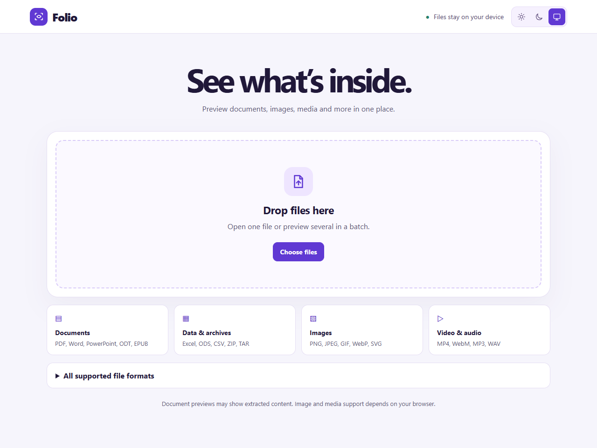

# Folio

Folio previews local files in the browser. Select or drop several files, then switch between them from the file list.

[Open the live demo](https://p1amrit.github.io/folio/)

## Run locally

Open `index.html` from the repository folder in a modern browser. GitHub Pages serves the same static files. There is no server or default build step.

After editing an inline script, run `node tools/build-html.cjs` to refresh the CSP hashes. Run `node tools/build-html.cjs Folio.html` to create a standalone copy that includes the stylesheet and libraries.

## Preview support

| Format | Preview |
| --- | --- |
| PDF | Page-by-page canvas rendering for files up to 64 MB |
| DOC, DOCX, DOCM, DOTX, DOTM, ODT and OTT | Extracted document text. Legacy DOC support covers unencrypted Word 97–2003 files up to 16 MB. |
| XLSX, XLSM, XLTX, XLTM, ODS, OTS, CSV and TSV | Worksheets or delimited rows, up to 500 rows and 100 columns |
| PPTX, PPTM, PPSX, PPSM, POTX, POTM, ODP and OTP | Extracted slide text |
| EPUB | Chapter text |
| PNG, JPEG, GIF, WebP, SVG, AVIF and other images | Image display, depending on browser support |
| MP4, WebM, MP3, WAV and other media | Playback, depending on browser and codec support |
| ZIP, TAR, CBZ, JAR, APK, AAB, WHL and KMZ | Archive member listing |
| TXT, Markdown, HTML, JSON, source code and other plain text | Source view |
| Other binary files | File size, media type when available, and a hexadecimal view of the first 256 bytes |

The demo’s **All supported file formats** panel lists every recognized extension.

## Security and privacy model

- The browser reads selected files through the File API. Folio has no upload endpoint, analytics, or server-side processing.
- A Content Security Policy blocks fetch and other scripted connections, frames, plug-ins, and form submissions. The hosted page allows same-origin app scripts and styles, and authorizes inline scripts by hash. The standalone copy uses hashes for its bundled code and styles.
- PDF.js draws pages to a canvas from local bytes. Folio does not create interactive PDF actions, links, or forms. Office previews extract text and cell values without running macros. HTML and source files are displayed as text.
- The hosting provider receives normal requests for the website and its static assets. Browser behavior outside the Folio page, such as opening a downloaded file, is outside this policy.

## License

Folio’s own code is [MIT licensed](LICENSE). The vendored [CFB](vendor/cfb-LICENSE.txt) and [PDF.js](vendor/pdfjs-LICENSE.txt) libraries retain their Apache-2.0 licenses.
